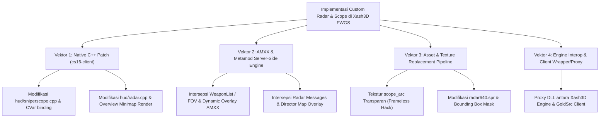

# TEKNIKAL KONTEKS: ANALISIS MASALAH RADAR & SNIPER SCOPE PADA ENGINE XASH3D FWGS

Dokumen ini disusun sebagai acuan teknis komprehensif bagi **Gemini 4 Argon** untuk menganalisis, meriset, dan merancang solusi arsitektur implementasi **Custom Radar (Modern Square / CS2 Style)** dan **Custom Sniper Scope (CS2 Frameless Reticle & Adjustable Width)** pada lingkungan mesin permainan **Xash3D FWGS 0.21** (Counter-Strike 1.6).

---

## 1. LATAR BELAKANG & IDENTIFIKASI MASALAH

Pada pengembangan antarmuka kustomisasi HUD sebelumnya, sistem berhasil membaca dan mengaplikasikan CVar crosshair reguler (ukuran, ketebalan, celah, warna RGB, titik tengah, dan T-shape). Namun, pengujian visual di dalam permainan mengungkap kendala arsitektural mendasar pada dua komponen spesifik:

```
+-----------------------------------------------------------------------------------+
|                            STATUS SUBSISTEM HUD DI XASH3D                         |
+-----------------------------------------------------------------------------------+
| 1. Crosshair Reguler   : [BERHASIL] Render dinamis & static cvar terbaca normal. |
| 2. Radar Square (CS2)  : [GAGAL]    Tetap berbentuk lingkaran klasik 2D.          |
| 3. Frameless Scope CS2 : [GAGAL]    Tetap tertutup busur hitam (scope_arc) 1px.   |
+-----------------------------------------------------------------------------------+
```

### A. Masalah 1: HUD Radar (Kegagalan Bentuk Kotak / Square Minimap)
1. **Perilaku yang Diharapkan**:
   - Pemain dapat mengaktifkan radar kotak modern gaya CS2 (`hud_radar_square 1`).
   - Radar menampilkan layout taktis denah peta (*overview minimap*) secara dinamis sesuai posisi dan rotasi pemain.
   - Penskalaan zoom radar (`hud_radar_scale`) dan penguncian orientasi utara (`cl_radar_locked`).
2. **Kondisi Faktual di Mesin Xash3D FWGS**:
   - Radar tetap dirender dalam wujud lingkaran klasik (*circular*) dengan radius tetap.
   - CVar `hud_radar_square` dan `hud_radar_scale` **tidak dikenal** (Unknown command / diabaikan) oleh biner `client.dll` aktif (`cstrike/cl_dlls/client.dll`).
   - Radar klasik hanya merender titik relatif (*blip dots*) rekan tim dan bom di atas sprite lingkaran (`sprites/radar640.spr`), tanpa adanya pemetaan tekstur denah peta (*overview texture*).
   - Penggantian sprite bingkai radar ke bentuk kotak secara statis tetap menghasilkan *clipping* titik pemain dalam radius lingkaran polar karena fungsi kalkulasi matematis di dalam `CHudRadar::Draw()` membatasi koordinat dengan rumus $x^2 + y^2 \le R^2$.

### B. Masalah 2: Sniper Rifle Scope (Kegagalan Mode Frameless CS2 & Pengaturan Garis)
1. **Perilaku yang Diharapkan**:
   - Saat membidik menggunakan AWP / Scout / SG550 / G3SG1, pemain dapat memilih gaya teropong modern CS2: **Frameless Reticle** (lingkaran hitam penutup layar dan *letterbox blackout* dihilangkan sehingga *peripheral vision* tetap terbuka luas).
   - Ketebalan garis silang teropong dapat diatur dinamis (`cl_crosshair_sniper_width 1-10`).
   - Dukungan efek *Dynamic Movement Blur* (`cl_crosshair_sniper_show_normal_inaccuracy 1`) dan penonaktifan goyangan bidikan (`cl_bob_sniper 0`).
2. **Kondisi Faktual di Mesin Xash3D FWGS**:
   - Fungsi `CHudSniperScope::Draw()` di dalam `client.dll` secara mutlak (*hardcoded*) merender 4 tekstur kuadran busur hitam (`sprites/scope_arc_nw.tga`, `scope_arc_ne.tga`, `scope_arc_sw.tga`, `scope_arc_se.tga`) serta tirai hitam di sisi kiri-kanan layar (*widescreen letterbox*).
   - Garis silang tengah selalu dirender statis dengan ketebalan 1 piksel hitam (`FillRGBA`).
   - CVar `cl_crosshair_sniper_width` dan `cl_crosshair_sniper_style` **tidak terdaftar** pada tabel CVar klien, sehingga nilai yang diatur melalui konsol maupun server AMXX tidak membawa perubahan visual apa pun.

---

## 2. AUDIT TEKNIS BINARY & ARSITEKTUR XASH3D FWGS

Investigasi mendalam terhadap lingkungan kerja (`D:\Counter-Strike 1.6\Counter-Strike 1.6 Original`) menghasilkan temuan teknis sebagai berikut:

### A. Perbedaan Biner Klien: Xash3D (CS16Client) vs GoldSrc Modern (GSClient)
Audit pemindaian simbol biner (`client.dll`) mengungkap akar jurang kompatibilitas:

| Parameter / Simbol | `cstrike/cl_dlls/client.dll` (Xash3D CS16Client) | `_backup_goldsrc_binaries/.../client.dll` (GoldSrc GSClient) |
| :--- | :--- | :--- |
| **Arsitektur Dasar** | Biner sumber terbuka `cs16-client` (FWGS fork) | Biner modifikasi resmi GoldSrc Valve (`hw.dll`) |
| **Simbol `hud_radar`** | **0 occurrences** (Tidak diimplementasikan) | **25 occurrences** (Mendukung `hud_radar_square`, scale, dll.) |
| **Simbol `cl_crosshair_sniper`**| **0 occurrences** (Tidak diimplementasikan) | **3 occurrences** (Mendukung `sniper_width`, style) |
| **Simbol `CHudRadar`** | 56 occurrences | 3 occurrences |
| **Simbol `CHudSniperScope`** | 12 occurrences | 0 occurrences (Dialihkan ke pipeline render kustom) |
| **Sprite Mask Scope** | 5 file `scope_arc*.tga` dimuat mutlak | Terintegrasi dengan logika render shader/primitif dinamis |
| **Pustaka UI Pendukung** | `menu.dll` (Xash3D Extended Menu API / SDL2) | `GameUI.dll` (VGUI2 Controls & skrip dialog `.res`) |

### B. Struktur Kode Sumber `cs16-client` (PDB Trace)
Analisis terhadap berkas debug `cstrike/cl_dlls/client.pdb` mengonfirmasi jalur build kode sumber klien aktif:
- `cl_dll/hud/radar.cpp`: Mengelola seluruh siklus hidup radar klasik, penerimaan pesan jaringan server (`HostagePos`, `HostageK`), dan penggambaran sprite `radar640.spr`.
- `cl_dll/hud/sniperscope.cpp`: Mengelola deteksi status zoom senjata sniper, penggambaran sprite busur `scope_arc*.tga`, dan penggambaran garis crosshair 1 piksel via `FillRGBA`.

### C. Mengapa Biner GoldSrc Tidak Bisa Dipasang Langsung ke Xash3D?
1. **Perbedaan ABI & Antarmuka Engine-Client**:
   - `client.dll` milik GoldSrc mengimpor fungsi-fungsi dari `hw.dll` / `sw.dll` dengan konvensi pemanggilan dan struktur `enginefuncs_t` standar Valve tahun 2003–2013.
   - Xash3D FWGS mengimplementasikan subsistem `ref_gl.dll` dan SDL2 dengan ekstensi API engine tersendiri. Memaksa pemuatan `client.dll` GoldSrc ke dalam `xash3d.exe` berujung pada kegagalan ekspor simbol (*missing DLL entry point*) atau *segmentation fault* saat inisialisasi render.
2. **Keterpisahan Sistem UI**:
   - Antarmuka VGUI2 (`OptionsSubHud*.res`) yang ada di folder `cstrike/resource/` digerakkan oleh `GameUI.dll`.
   - Xash3D FWGS mengabaikan `GameUI.dll` dan menjalankan `menu.dll` (mainui_cpp), sehingga tab kustomisasi VGUI2 tidak dimuat ke dalam menu Options bawaan engine.

---

## 3. IDENTIFIKASI ASSET EKSISTING DI WORKSPACE

Direktori proyek telah memiliki aset pendukung yang relevan:
1. **Berkas Terkait Scope di `cstrike/sprites/`**:
   - `scope_arc_nw.tga`, `scope_arc_ne.tga`, `scope_arc_sw.tga`, `scope_arc_se.tga`, `scope_arc.tga` (Tekstur kuadran lingkaran teropong hitam).
   - `scope_lens.tga` (Tekstur pantulan kaca lensa).
   - `scope_line_blur.tga` (Tekstur garis blur).
   - `sniper_scope.spr` (Definisi sprite scope).
2. **Berkas Terkait Radar di `cstrike/sprites/`**:
   - `radar320.spr`, `radar640.spr`, `radaropaque640.spr` (Sprite dasar radar lingkaran).
   - `hud.txt` (Mendefinisikan mapping koordinat sprite radar).
3. **Berkas Skrip UI di `cstrike/resource/`**:
   - `OptionsSubHudCrosshairSniperPage.res`: Kontrol slider ketebalan scope dan combo style.
   - `OptionsSubHudMiscPage.res`: Kontrol bentuk radar dan warna global.

---

## 4. VEKTOR SOLUSI YANG MEMERLUKAN ANALISIS & DESAIN DARI GEMINI 4 ARGON

Gemini 4 Argon diminta untuk menganalisis 4 (empat) jalur teknis (Vektor) guna mengimplementasikan Radar Kotak dan Frameless Scope di ekosistem Xash3D FWGS:



### Vektor 1: Modifikasi Kode Sumber Tingkat Klien (Native `cs16-client` Rebuild)
Sebagai proyek *open-source*, kode sumber `cs16-client` (FWGS) dapat dimodifikasi dan dikompilasi ulang:
- **Kustomisasi Scope (`hud/sniperscope.cpp`)**:
  - Bagaimana menyisipkan CVar `cl_crosshair_sniper_width` (1-10 px) dan `cl_crosshair_sniper_style` (0=Classic, 1=Frameless CS2, 2=Dot Only, 3=Dynamic Blur).
  - Algoritma penggambaran garis horizontal dan vertikal via TriAPI / OpenGL `pfnFillRGBABlend` saat mode Frameless aktif (melewati pemanggilan kuadran `scope_arc*.tga` dan letterbox).
  - Rumus matematika peluruhan blur saat bergerak (*inaccuracy blur scaling* berbasis `cl_crosshair_sniper_show_normal_inaccuracy`).
- **Kustomisasi Radar (`hud/radar.cpp`)**:
  - Bagaimana menambahkan CVar `hud_radar_square`, `hud_radar_scale`, dan `cl_radar_rotate`.
  - Logika penggambaran *bounding box* persegi empat dengan latar semi-transparan.
  - Mekanisme integrasi *overview map* (memuat tekstur denah peta `overviews/<mapname>.tga` atau `.bmp` dan memproyeksikan koordinat dunia pemain $X, Y$ ke koordinat UV radar).
- **Prosedur Kompilasi**:
  - Rekomendasi toolchain (CMake + MinGW-w64 i686 atau MSVC x86 32-bit) agar biner `client.dll` yang dihasilkan kompatibel 100% dengan `xash3d.exe` v0.21.

### Vektor 2: Solusi AMX Mod X Server-Side & Metamod Hooks
Jika klien `client.dll` dipertahankan tanpa kompilasi ulang kode C++:
- **Sniper Scope**:
  - Bisakah server mendeteksi saat pemain membidik (`m_iFOV < 90` via HamSandwich `Ham_Item_Deploy` / `SetFOV` atau `CurWeapon`) lalu menginjeksi overlay visual pengganti?
  - Keterbatasan teknis: batas refresh rate pesan jaringan, channel HUD message flicker, dan latensi.
- **Radar**:
  - Apakah AMXX dapat memanipulasi pesan jaringan `HostagePos`, `HostageK`, atau mengirimkan paket `Director` untuk mengontrol posisi radar?
  - Bisakah entitas khusus di sisi server memancarkan data yang diterjemahkan klien?

### Vektor 3: Rekayasa Aset & Tekstur (Asset Pipeline / Sprite Modding)
Solusi tanpa pengubahan kode biner (zero binary modifications):
- **Frameless Scope via Alpha Masking**:
  - Bagaimana cara kerja penggantian tekstur `cstrike/sprites/scope_arc*.tga` dengan tekstur berkanal alpha transparan penuh (0% opacity)?
  - Apakah hal ini otomatis menghilangkan lingkaran hitam teropong di Xash3D dan menyisakan pandangan frameless?
  - Apa konsekuensinya terhadap garis tengah bawaan (tetap 1 px hitam) dan bagaimana cara mengoptimalkan kontrasnya?
- **Square Radar Frame**:
  - Merancang ulang `radar640.spr` dengan bingkai kotak.
  - Bagaimana mengatasi keterbatasan kalkulasi lingkaran bawaan agar ikon pemain di pojok kotak tidak terpotong secara anomali?

### Vektor 4: Analisis Interoperabilitas / Client Proxy Wrapper
- Mengkaji apakah dimungkinkan membuat pustaka jembatan (*wrapper/hook DLL*) yang mengonversi panggilan fungsi engine Xash3D ke format yang dipahami oleh `client.dll` milik GoldSrc (GSClient), atau mengapa pendekatan ini berisiko tinggi terhadap stabilitas memori dan performa.

---

## 5. PERSYARATAN & INTEGRASI SISTEM EKSISTING

Riset yang dilakukan oleh Gemini 4 Argon harus mematuhi batasan arsitektur proyek:
1. **Kompatibilitas Penuh Bot YaPB & Bot Savage AI**:
   - Seluruh logika radar dan scope tidak boleh mengganggu pembacaan waypoint, navigasi C4, atau komputasi aim bot di `bot_savage_ai.sma`.
2. **Sistem Kompetitif MR12 (`csgo_competitive.sma`)**:
   - Tidak boleh mengonsumsi channel HUD kritis yang digunakan oleh scoreboard, timer babak, dan status match MR12.
3. **Penyimpanan Profil Persisten (nvault)**:
   - Skema penyimpanan pengaturan radar dan scope pemain ke dalam database lokal `cs2_crosshair.nvault` / `cs2_hud.nvault` yang terintegrasi dengan perintah in-game (`say /hud`, `say /scope`, `say /radar`).
