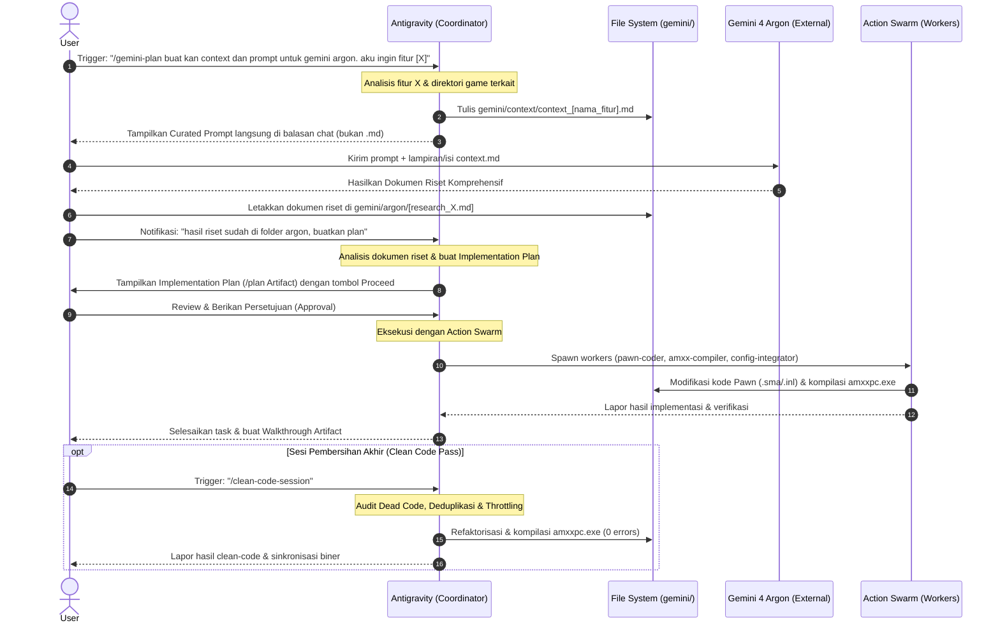

# WORKFLOW SPESIFIKASI: GEMINI 4 ARGON RESEARCH & SWARM IMPLEMENTATION

Workflow ini adalah pipeline terstandarisasi untuk meriset, merancang, mereview, dan mengimplementasikan fitur atau modifikasi baru pada proyek Counter-Strike 1.6 / Xash3D Engine.

---

## 1. STRUKTUR DIREKTORI WORKFLOW (`gemini/`)

Semua artefak workflow dikelompokkan ke dalam folder `gemini/` dengan sub-folder khusus:

```
D:\Counter-Strike 1.6\Counter-Strike 1.6 Original\gemini\
├── context\     <- Menyimpan file konteks proyek (context_<nama_fitur>.md) yang digenerate AI
├── argon\       <- Tempat User menaruh dokumen hasil riset dari Gemini 4 Argon
├── workflow\    <- Berisi dokumen spesifikasi dan panduan alur kerja (WORKFLOW.md)
└── actions\     <- Berisi spesifikasi aksi, role swarm, dan integrasi tools (ACTIONS.md)
```

> [!IMPORTANT]
> **ATURAN MUTLAK**: Jangan pernah membuat folder `.agents` di dalam direktori `D:\Counter-Strike 1.6\Counter-Strike 1.6 Original\`. Seluruh konfigurasi workflow harus tetap berada di dalam `gemini/` dan file aturan `GEMINI.md` di root proyek.

---

## 2. TAHAPAN ALUR KERJA (LIFECYCLE)



---

## 3. DETAIL SETIAP TAHAP

### Tahap 1: Trigger & Pembuatan Context + Prompt
1. **User Trigger**:
   User mengetik:
   `"/gemini-plan buat kan context dan prompt untuk gemini argon. aku ingin fitur <deskripsi fitur>"`
2. **Tindakan Model (Antigravity)**:
   - Model membedah kebutuhan fitur tersebut.
   - Model mengidentifikasi file-file engine, konfigurasi, dan modul yang relevan (misalnya: `cs2_modern_engine.sma`, `bot_savage_ai.sma`, `csgo_competitive.sma`, `cstrike/addons/metamod/`, dll.).
   - Model membuat file konteks dengan nama yang menyesuaikan fitur:
     `gemini/context/context_<nama_fitur>.md`
   - Model memberikan **Curated Prompt** langsung pada teks balasan chat (format blockquote / codeblock siap-copy), bukan dibuatkan file `.md`.

### Tahap 2: Riset oleh Gemini 4 Argon
1. User menyalin prompt dari chat dan membawanya ke Gemini 4 Argon bersama isi dari `gemini/context/context_<nama_fitur>.md`.
2. Gemini 4 Argon menghasilkan Technical Research Document.
3. User menyimpan hasil riset tersebut ke dalam folder:
   `gemini/argon/<nama_file_riset>.md`

### Tahap 3: Analisis & Pembuatan Implementation Plan (`/plan`)
1. User memberi instruksi bahwa hasil riset sudah ada di folder `gemini/argon/`.
2. Model membaca dokumen riset dari `gemini/argon/`.
3. Model menyilangkan (cross-reference) temuan riset dengan kode eksisting proyek di `cstrike/addons/amxmodx/scripting/`.
4. Model membuat file **Implementation Plan Artifact** (`/plan`) dengan metadata `request_feedback: true` dan `user_facing: true`.

### Tahap 4: Review & Persetujuan User
1. User meninjau rencana teknis pada panel artifact.
2. User dapat meminta penyesuaian atau langsung menyetujui plan.
3. Model **TIDAK BOLEH** menulis atau memodifikasi file game sebelum user memberikan persetujuan eksplisit.

### Tahap 5: Eksekusi via Action Swarm
1. Setelah disetujui, Model bertindak sebagai **Swarm Coordinator** dan memanggil tool `swarm` (`action: add`).
2. Tim pekerja (workers) dibagi sesuai perannya:
   - `pawn-coder`: Menulis atau mengedit source code Pawn (`.sma` atau submodul `.inl`).
   - `amxx-compiler`: Menjalankan kompilasi biner menggunakan `cstrike/addons/amxmodx/scripting/amxxpc.exe` dan memvalidasi nol error/warning.
   - `config-integrator`: Mendaftarkan plugin di `plugins-competitive.ini` / `plugins-deathmatch.ini`, mengatur cvar di `.cfg`, dan menyiapkan direktori aset.
3. Setelah swarm menyelesaikan tugasnya, Model membuat dokumen **Walkthrough Artifact** (`walkthrough.md`) yang merangkum hasil kerja dan petunjuk pengujian dalam game.

### Tahap 6: Post-Feature Refactoring & Debt Elimination (`/clean-code-session`)
1. **User Trigger**:
   User mengetik `"/clean-code-session"` setelah fitur terverifikasi berjalan lancar (*flawless*) dalam pengetesan game.
2. **Tindakan Model (Antigravity)**:
   - Melakukan audit menyeluruh terhadap file target yang baru saja diiterasi.
   - Mengeliminasi *dead code*, *unused headers/macros/tasks*, serta sisa log debug verbose (`log_amx`).
   - Melakukan deduplikasi logika (DRY) dan menerapkan *throttling* resource engine.
   - Menguji ulang kompilasi biner dengan `amxxpc.exe` hingga 0 error dan 0 warning.
   - Mensinkronisasi file biner `.amxx` ke runtime server dan memberikan laporan audit bersih kepada user.
